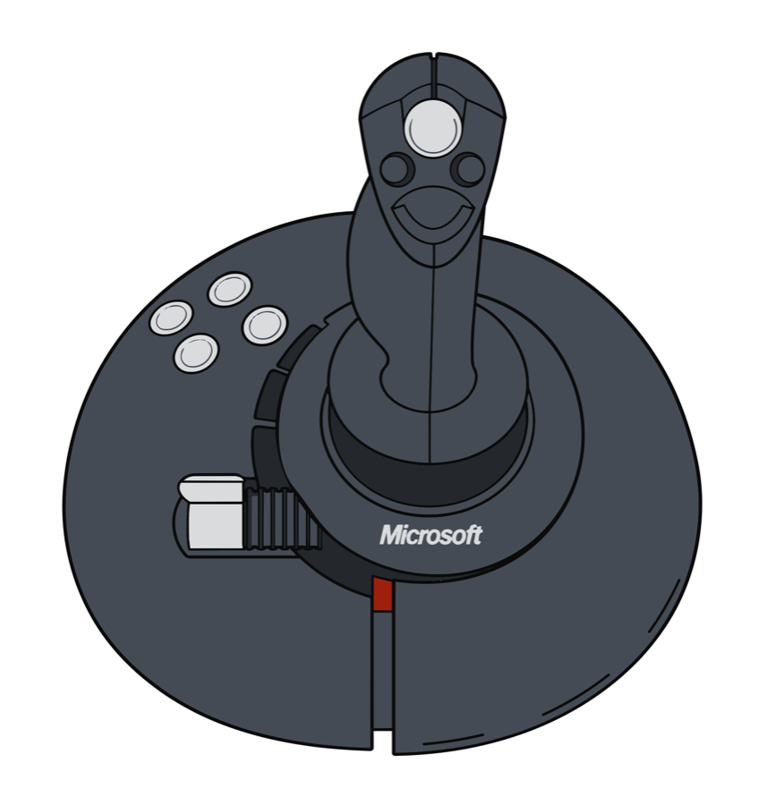

# Sidewinder FF2

A Python driver for the Microsoft SideWinder Force Feedback 2, a joystick from
1998 with motors in the base. You can read every control (stick, twist, thrust
lever, hat, eight buttons) and make the stick push back, from a script, a game
loop or a Jupyter notebook. No sudo, no game, no Windows-only SDK.



The stick is cheap second hand and is still one of the few consumer devices that
can push on your hand with a programmable force. Nothing supports it any more on
macOS, so this talks to it directly over USB (HID). Written and tested on macOS;
there is nothing macOS-specific in it, so Linux and Windows should work too.

It was written for [lammps-live](https://github.com/stefanhuber1993/lammps-live),
where you push a bead around in a live molecular dynamics simulation and feel the
forces on it. But nothing in here knows about that: it's just a joystick.

## Setup

```bash
./setup.sh                  # installs hidapi, makes a venv, installs the Python deps
source venv/bin/activate
python3 monitor.py          # live view of every control
python3 demo.py             # a few effects, hold the stick
```

**Hold the stick.** There's a hand sensor in the grip and the motors are off
while nobody holds it. Effects still upload fine and report that they're
playing, they just don't do anything. This is the most confusing thing about the
device.

On Linux you need a udev rule, on Windows `hidapi.dll`: see
[Platform support](docs/details.md#platform-support).

## Reading the stick

```python
from sidewinder.ff2 import FF2Device

ff = FF2Device()
s = ff.read_input()      # None until the stick has sent its first report

s.x, s.y                 # stick, -1..1. Careful: pushing forward gives NEGATIVE y
s.twist                  # twisting the handle, -1 left .. +1 right
s.throttle               # thrust lever, 0 idle .. 1 full forward
s.hat                    # the little hat on top, (dx, dy) each -1/0/+1
s.button(1)              # True while button 1 (the trigger) is held
```

The device only sends something when a control changes, so a still stick sends
nothing, and `read_input()` returns `None` until you first touch it.
`ff.get_events()` gives you button presses and hat moves as events, if your
program is a frame loop.

## Making it push back

Every effect starts playing as soon as you create it, and returns an object you
can change while it plays, or `free()` when you're done (the device only holds
15 at a time).

```python
# Directions: 0 = pushes the stick back towards you, 90 = left,
# 180 = forward, 270 = right. Not the compass, that's how the device does it.
# Strengths: magnitude 0..255.

# A steady push in one direction.
push = ff.constant_force(angle_deg=270, magnitude=150)

# Shaking. period_ms is the length of one shake, so 60 ms is a buzz and
# 500 ms a slow wobble. Also square, triangle, sawtooth_up, sawtooth_down.
buzz = ff.sine(angle_deg=90, magnitude=80, period_ms=60)

# A spring pulling the stick to a point. stiffness 0..127 is how hard it
# pulls; cp_offset_x/y -128..127 is where the point is (0 = centre).
spring = ff.spring(stiffness=100, cp_offset_x=50, cp_offset_y=0)

# Resistance that depends on how you move the stick, not where it is.
# coefficient / level 0..127.
damper   = ff.damper(coefficient=80)    # like moving it through honey
inertia  = ff.inertia(coefficient=80)   # like it has a heavy mass
friction = ff.friction(level=80)        # like it drags on a surface

# Change an effect while it plays, e.g. every frame of a game.
# axis 0 is left/right, axis 1 forward/back.
spring.set_condition(axis=0, cp_offset=-30, pos_coeff=127, neg_coeff=127)
push.set_constant_force(magnitude=255)

buzz.free()              # stop it and give its slot back
ff.close()
```

Effects are also context managers (`with ff.sine(...): ...`), which frees them
for you.

## In a game loop

```python
while running:
    s = ff.read_input()
    if s is None:
        continue
    ship.x += s.x * speed * dt
    buzz.set_periodic(magnitude=int(s.throttle * 90), period_ms=60)  # engine rumble
```

`examples/pygame_demo.py` is a small playable version of this, with a centring
spring, an airbrake damper and a kick when you fire (`pip install pygame` first).
Don't use `pygame.joystick` for this stick: on macOS SDL doesn't even see it.

## More

- [docs/details.md](docs/details.md): how it works, per-platform setup, the exact
  bytes every call sends, the full control map, the HID protocol, and a long list
  of gotchas
- `notebook.ipynb`: try every effect with sliders. `theremin.ipynb`: springs as
  musical frets
- `discover.py` dumps the device's own description of itself, `monitor.py` shows
  every control live
- Tests run without the joystick: `venv/bin/python -m pytest tests/ -q`
